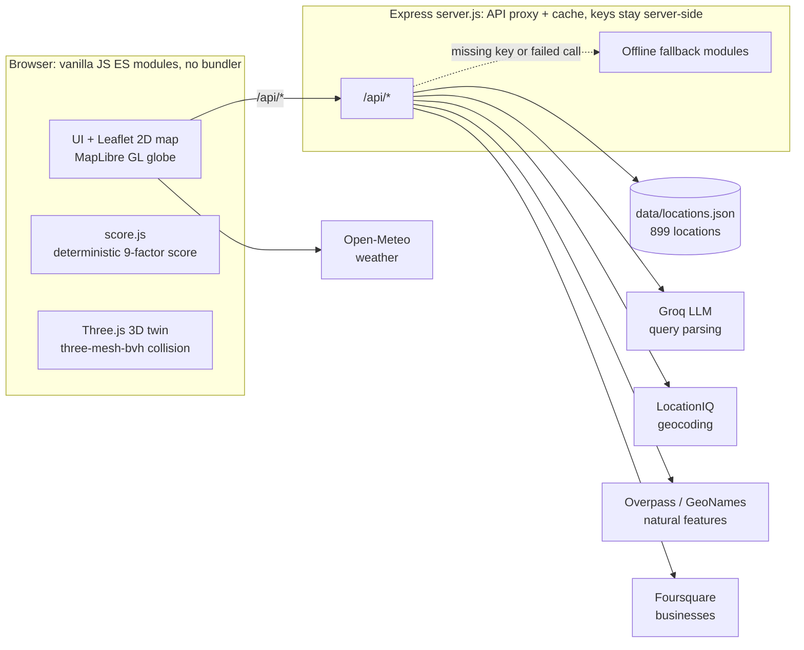

# SceneScout

**TL;DR:** Describe a film/photo shoot location in plain English and SceneScout finds matching places on a map, scores how well each fits your brief, and lets you walk through a procedurally generated 3D model of the space.

<!-- TODO: add a screenshot or GIF, e.g. save it as docs/demo.gif and uncomment:

-->

Built in July 2026 for a hackathon (theme: *Reimagine Creative Industries with AI*). It's no longer under active development and lives on as a portfolio project.

Built with AI-assisted development: IBM Bob was used throughout.

## Features

- **Natural-language search.** Type something like *"modern industrial warehouse with big windows near downtown Chicago, under $500 a day"*. An LLM (Groq) turns it into structured filters: building type, style, light, size, budget, radius, and location. If no Groq key is set, a local keyword parser takes over.
- **899-location catalog plus live search.** The bundled catalog is built from four public US real-estate datasets. Live OpenStreetMap natural-feature search (lakes, parks, mountains…) and Foursquare business search cover what the catalog doesn't.
- **Explainable suitability score.** Every result gets an overall match percentage and a nine-factor breakdown, with a short written reason for each factor.
- **Walkable 3D digital twin.** Floor plans are generated procedurally for each property and rendered in Three.js. You can click to walk around with BVH mesh collision, take a cinematic flythrough, or switch to a dollhouse view.
- **Shoot logistics.** Sunrise, sunset, and golden-hour times are computed from each location's coordinates. Weather comes from Open-Meteo, and there are links out to Street View, Google Earth, and directions.
- **Explore Globe and script breakdown.** Scout anywhere on a 3D globe, or upload a screenplay PDF to pull out the locations, scene headings, and budget figures it mentions.

## Architecture



### How the suitability score works

The score is **a deterministic weighted formula** in [`js/score.js`](js/score.js), not LLM output. The LLM only parses your brief into structured filters. The score itself is plain arithmetic, so the same inputs always give the same result and every factor can be explained.

| Factor | Weight | Source |
|---|---|---|
| Visual Match | 26 | Requested type and style keywords vs. the listing's tags and description |
| Lighting | 16 | Requested vs. listed light level |
| Space & Scale | 12 | Requested minimum ft² vs. listed ft² |
| Parking | 9 | Modeled production intel |
| Accessibility | 9 | Modeled production intel |
| Noise Level | 9 | Modeled production intel |
| Privacy | 8 | Modeled production intel |
| Production Friendliness | 7 | Modeled production intel |
| Permit Complexity | 4 | Modeled production intel |

The overall score is the weighted average of the nine factors. Locations that go over your stated budget lose up to 18 points.

### Fallbacks when API keys are missing

Every keyed service has a fallback, so the app runs with no `.env` at all. The browser still needs internet access for map tiles, weather, and Overpass.

| Service | What happens without a key, or when the call fails |
|---|---|
| Groq (query parsing) | Local keyword parser (`parse-query-fallback.js`) |
| LocationIQ (forward geocoding) | Bundled list of 128 US cities (`data/offline-centers.json`); matches city names only |
| LocationIQ (reverse geocoding) | No fallback; Explore Globe shows raw coordinates instead of a place name |
| Overpass → GeoNames (natural features) | 49 bundled well-known US landmarks (`data/offline-natural-features.json`) |
| Foursquare (business search) | Empty result |

## Running it

Requires **Node.js 20.19+ or 22.9+**, because `npm run dev` uses `node --env-file-if-exists`.

```bash
git clone https://github.com/U-daya/GeoPhoto.git
cd GeoPhoto
npm install
npm run dev
```

Then open **http://localhost:3001**.

Optional: add API keys in a `.env` file in the project root to turn on live AI parsing, precise geocoding, and live search:

```
GROQ_API_KEY=your_groq_key            # console.groq.com/keys (free tier)
LOCATIONIQ_KEY=your_locationiq_key    # locationiq.com/register (free tier)
GEONAMES_USERNAME=your_username       # geonames.org/login (free; enable "web services")
FOURSQUARE_API_KEY=your_foursquare_key  # foursquare.com/developers
```

## What's real vs. simulated

**Real:**
- Locations and square footage of the 899 catalog entries, from four Kaggle datasets: Zillow US House Listings 2023 (598), Southern States Zillow listings (150), NYC Property Sales (121; coordinates are ZIP-code centroids), and King County House Sales (30). See `scripts/build-catalog.js`.
- LLM query parsing (when a Groq key is set).
- Solar timing and weather.
- Live natural-feature and business search.
- The 3D engine.

**Derived or simulated:**
- Most building types are inferred heuristically. Building types for NYC entries come from real building-class codes.
- Daily rates and light levels are derived from the listing data.
- The production-intel factors (parking, accessibility, noise, privacy, power, permits) and the review summaries are generated.
- Interiors are procedural, not scanned.

The app labels this data as simulated.

## AI-assisted development

SceneScout was built with AI-assisted development tools: **IBM Bob** and **Claude Code**. Much of the commit history was written through Claude Code, and the rest by the team.

## My contributions

SceneScout began as a hackathon project. These are the parts I built and owned:

- **AI search:** integrated the Groq LLM to turn free-text briefs into structured search filters, with a local keyword-parser fallback.
- **3D digital twin:** took the walkthrough from prototype to realistic. I added procedural textures, environment lighting, bloom and tone mapping, and fixed first-person movement bugs.
- **Explore Globe:** found and fixed a race condition in the map projection setup that made the first click fail.
- **UI polish:** fixed layout clipping in the filter sidebar, removed visual clutter, and added Street View and Google Earth links to the globe click panel.
- **Integration:** resolved merge conflicts between parallel implementations of the 3D renderer from different branches.
- **Portfolio release:** rewrote this README, corrected inaccurate claims, fixed the LocationIQ key-check bug, and cleaned up leftover build files.
